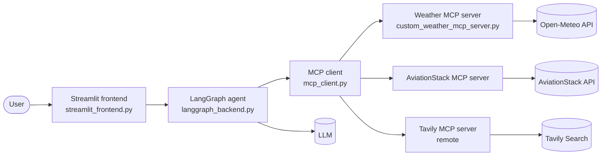

<div align="center">

#  ItinerAI: AI Travel Planner with LangGraph and MCP

**A Streamlit travel-planning assistant powered by a LangGraph agent that calls live tools (weather, flights and web search) through Model Context Protocol (MCP) servers.**


</div>

---

##  About

**ItinerAI** is a travel planner app that turns a simple chat message into a researched travel plan. Instead of relying only on what a language model remembers, the agent **calls real tools** to fetch current information:

-  **Weather** for the destination
-  **Flight information** from AviationStack
-  **Web search** results from Tavily

The tools are exposed as **MCP servers**, the agent is orchestrated with **LangGraph**, and the user interacts through a **Streamlit** chat interface.

---

##  Features

| Feature | Description |
| --- | --- |
|  **Chat-based planning** | Describe your trip in plain English in the Streamlit UI |
|  **LangGraph agent** | The agent decides which tools to call and combines the results into a plan |
|  **MCP tool servers** | Weather, flights and search are separate, reusable MCP servers |
|  **Custom weather server** | A weather MCP server built in this repo, using Open-Meteo data |
|  **Flight data** | Flight lookups through an AviationStack MCP server |
|  **Live web search** | Up-to-date travel info through a remote Tavily MCP server |
|  **Test scripts** | Standalone scripts to test each MCP server on its own |

---

## 🏗️ Architecture



**How a request flows**

1. The user types a trip request in the Streamlit chat.
2. The frontend sends it to the LangGraph backend.
3. The agent reasons about what it needs and calls tools through the MCP client.
4. Each MCP server fetches data from its external API and returns it.
5. The agent combines everything into an itinerary and the frontend displays it.

>  This diagram follows the file names. Adjust it to match the exact flow in `langgraph_backend.py` and `mcp_client.py`.

---

## 🔌 MCP Servers

| File | Purpose | Type |
| --- | --- | --- |
| [`custom_weather_mcp_server.py`](./custom_weather_mcp_server.py) | Weather MCP server (main version) | Local, custom-built |
| [`custom_weather_mcp_server3.py`](./custom_weather_mcp_server3.py) | Weather MCP server (later iteration) | Local, custom-built |
| [`text3_mcp_weather_openmeteo.py`](./text3_mcp_weather_openmeteo.py) | Weather experiment using the Open-Meteo API | Local |
| [`custom_mcp_server_weather_testing.py`](./custom_mcp_server_weather_testing.py) | Test script for the custom weather server | Testing |
| [`aviationstack-mcp`](./aviationstack-mcp) | AviationStack flight data MCP server | Local |
| [`local_aviationstack_testing_mcp_server.py`](./local_aviationstack_testing_mcp_server.py) | Test script for the AviationStack server | Testing |
| [`remote_tavily_testing_mcp_server.py`](./remote_tavily_testing_mcp_server.py) | Test script for the remote Tavily MCP server | Testing, remote |

>  State which weather file the app actually uses (`custom_weather_mcp_server.py` or `custom_weather_mcp_server3.py`), and consider moving older versions into an `archive/` folder.

---

##  Tech Stack

| Layer | Technology |
| --- | --- |
| **Frontend** | Streamlit |
| **Agent orchestration** | LangGraph |
| **Tool protocol** | Model Context Protocol (MCP) |
| **Weather data** | Open-Meteo |
| **Flight data** | AviationStack API |
| **Web search** | Tavily |
| **Language** | Python |

> See [`requirements.txt`](./requirements.txt) for the full dependency list.

---

##  Repository Structure

```
itinerai-langgraph-mcp/
├── streamlit_frontend.py                    # Streamlit chat UI
├── langgraph_backend.py                     # LangGraph agent and workflow
├── mcp_client.py                            # Connects the agent to the MCP servers
│
├── custom_weather_mcp_server.py             # Custom weather MCP server
├── custom_weather_mcp_server3.py            # Weather server, later iteration
├── text3_mcp_weather_openmeteo.py           # Open-Meteo weather experiment
├── aviationstack-mcp                        # AviationStack MCP server
│
├── custom_mcp_server_weather_testing.py     # Test: weather server
├── local_aviationstack_testing_mcp_server.py# Test: AviationStack server
├── remote_tavily_testing_mcp_server.py      # Test: remote Tavily server
│
├── requirements.txt                         # Python dependencies
├── .gitignore
└── README.md
```

---

### Prerequisites

- Python 3.10+
- API keys for the services you want to use:
  - An LLM provider key
  - [AviationStack](https://aviationstack.com/) (flights)
  - [Tavily](https://tavily.com/) (web search)
  - Open-Meteo needs no key

### Installation

**1. Clone the repository**

```bash
git clone https://github.com/SyedaNaziaGit/itinerai-langgraph-mcp.git
cd itinerai-langgraph-mcp
```

**2. Create and activate a virtual environment**

```bash
python -m venv venv

# Windows (PowerShell)
venv\Scripts\Activate.ps1

# macOS / Linux
source venv/bin/activate
```

**3. Install the dependencies**

```bash
pip install -r requirements.txt
```

**4. Create your `.env` file**

Create a `.env` file in the project root and add your keys:

```
OPENAI_API_KEY=your_llm_api_key_here
AVIATIONSTACK_API_KEY=your_aviationstack_key_here
TAVILY_API_KEY=your_tavily_key_here
```

>  Rename these variables to exactly what your code reads (check the `os.getenv(...)` calls), and swap in your LLM provider.

---

##  Running the App

Start the Streamlit frontend from the project root:

```bash
streamlit run streamlit_frontend.py
```

Then open the local URL Streamlit prints (usually `http://localhost:8501`) and start chatting.

---

##  Testing the MCP Servers

Each MCP server has its own script so you can check it before running the whole app.

```bash
# Weather server
python custom_mcp_server_weather_testing.py

# AviationStack server
python local_aviationstack_testing_mcp_server.py

# Remote Tavily server
python remote_tavily_testing_mcp_server.py
```

>  Adjust the commands if any script needs arguments or an MCP launcher such as `fastmcp dev`.

---

##  Example Prompts

```
Plan a 4-day trip to Goa next month. Check the weather and suggest what to pack.
```

```
Find flight options from Bengaluru to Delhi tomorrow and tell me what the weather will be like on arrival.
```

```
What are the top things to do in Jaipur this weekend? Build a one-day itinerary.
```

---

##  Note

- **Never commit secrets.** Keep API keys only in a local `.env` file and list `.env` in `.gitignore`.
- Share a `.env.example` file instead, with placeholder values:

```
OPENAI_API_KEY=
AVIATIONSTACK_API_KEY=
TAVILY_API_KEY=
```

- **Do not commit your virtual environment** (`venv/`, `myenv/`) or editor settings. Add them to `.gitignore`.
- If a key was ever pushed to a public repo, **rotate it** at the provider. Deleting the file later does not remove it from git history.

---

##  Troubleshooting

| Problem | Fix |
| --- | --- |
| `ModuleNotFoundError` | Activate the virtual environment and run `pip install -r requirements.txt` again |
| Missing or invalid API key | Check `.env` is in the project root and the variable names match the code, then restart the app |
| MCP server fails to start | Run its test script on its own to see the error message |
| Flight search returns nothing | Check your AviationStack plan and quota, since free plans are limited |
| Web search fails | Confirm the Tavily key is valid and the remote MCP URL is reachable |
| Streamlit shows an old state | Stop the app, clear the cache from the Streamlit menu, and rerun |

---

⭐ If you found this project useful, consider giving it a star!
